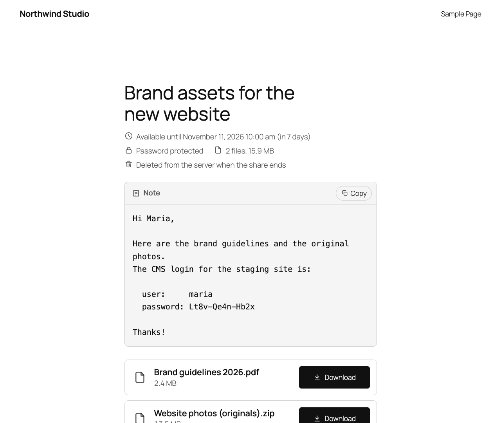
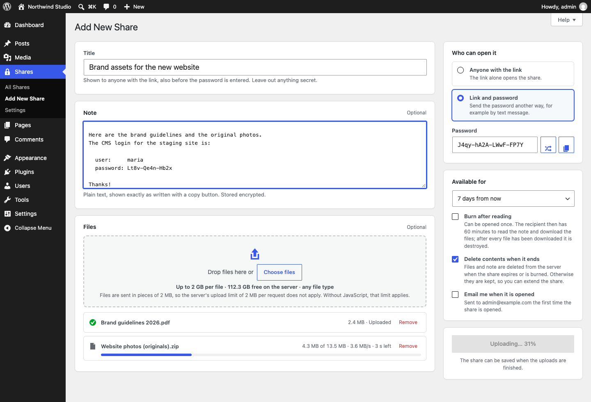

# Nemvo Share

Share notes and files from WordPress through secret links, with optional passwords, expiry and burn after reading. Files are encrypted on your own server and can only be downloaded through the link.



## What it does

- **Notes, files or both.** Write a note, drag in files, or both. Uploads show a progress bar with speed and time left, and go up in chunks, so PHP's upload limit doesn't cap the file size. The limits and free disk space are shown where you upload.
- **Secret links.** Every share gets a link like `https://example.com/share/k3XwP9…/` (24 random characters, 143 bits). Copy it, email it, preview it, switch it off, or give the share a new link.
- **Link only, or link and password.** Chosen per share. Strong passwords are generated for you (`Kp7w-M3qa-xT9e-Vh4c`) or you type your own. Recipients use a normal form on your site, not HTTP basic auth. Five wrong passwords pause attempts for 15 minutes.
- **Time limits.** 1 hour, 1 day, 7 days, 30 days, a date you pick, or no limit.
- **Burn after reading.** The share can be opened once. The recipient first sees an Open button, so link previews in Slack, Teams or Outlook don't use it up. After opening, that browser has a set time (60 minutes by default) to read and download, and the share is destroyed as soon as every file has been downloaded completely. A note on its own is destroyed the moment it's shown.
- **Automatic deletion.** Optionally delete files and note from the server when a share expires or is burned. Expiry and burning are enforced on every request; an hourly clean-up handles links nobody visits.
- **Looks like your site.** The share opens inside a normal WordPress page, with your theme's header, footer, fonts and buttons, in block and classic themes. The recipient sees the title, the share's settings (expiry, burn after reading, password, deletion), the note with a copy button, and a download button next to each file name.
- **Activity.** Views, downloads, wrong passwords, expiry and burning per share, without recording who. Optional email the first time a share is opened.



## Security

| | |
|---|---|
| Files on disk | Encrypted with XChaCha20-Poly1305 in 256 KiB blocks, a random key per file. Block number and file size are authenticated, so blocks can't be swapped, reordered or cut off. Independent blocks make resumable (Range) downloads possible. |
| Storage folder | `wp-content/uploads/nemvo-share-<random>/` with Apache and IIS deny rules, random file names without extensions. Settings and Site Health test it with a real request and show the nginx rule if needed. `NEMVO_SHARE_STORAGE` moves it outside the web root. |
| Database | Notes, links, passwords and file keys are encrypted. Links are found by their SHA-256 hash. Passwords are also hashed with `wp_hash_password()`. |
| Encryption key | Random key in the options table, or `NEMVO_SHARE_KEY` in wp-config.php so shares created with it can't be decrypted from a database copy alone. Both keys are tried when decrypting, so adding the constant later keeps older shares readable (with the database key's weaker protection). |
| Access | After the password, an HttpOnly, SameSite=Lax cookie scoped to the share's path, signed with the site's salts and bound to the current password hash, link and burn claim. Changing the password or link logs everyone out of the share. |
| Burn after reading | One browser claims the share in an atomic `UPDATE … WHERE opened_at IS NULL`; any other browser gets 410 Gone from then on. |
| Responses | Share pages: `Cache-Control: no-store`, `X-Robots-Tag: noindex`, `Referrer-Policy: no-referrer`, `DONOTCACHEPAGE`, kept out of sitemaps and page lists. Downloads: always `attachment`, `application/octet-stream`, `nosniff`, `Content-Security-Policy: sandbox`. |
| Deleting | Removing a file deletes it and its key, so copies in old backups can't be decrypted with a newer database. |

## Requirements

WordPress 6.2 or later, PHP 7.4 or later. The PHP sodium extension is used when available (it is in nearly every PHP build); otherwise WordPress's bundled sodium_compat does the encryption, more slowly.

## Install

Download `nemvo-share-x.y.z.zip` from [Releases](https://github.com/fpoller/nemvo-share/releases) and upload it under **Plugins › Add New › Upload Plugin**. Activating it creates a **Share** page; links open under `/share/…`. Then go to **Shares › Add New Share**.

Recommended: open **Shares › Settings** and copy the `define( 'NEMVO_SHARE_KEY', '…' );` line into wp-config.php.

## Configuration

Everything is on the settings page: the share page, defaults for new shares, the largest file, the burn-after-reading window, how long a password is remembered, how long ended shares are kept, the button colour, and whether uninstalling deletes everything.

| wp-config.php constant | Purpose |
|---|---|
| `NEMVO_SHARE_KEY` | Encryption key kept out of the database. Any long random string; the settings page generates one. |
| `NEMVO_SHARE_STORAGE` | Absolute path of a writable folder for the files, for example outside the web root. Move existing files there yourself. |

| Filter / action | Purpose |
|---|---|
| `nemvo_share_capability` | Capability needed to manage shares (default `manage_options`). |
| `nemvo_share_password_attempts` | Wrong passwords before the 15-minute pause (default 5). |
| `nemvo_share_client_ip` | Visitor IP for the rate limit, for sites behind a reverse proxy. |
| `nemvo_share_downloaded` (action) | A file was downloaded completely. Receives the share and file rows. |
| `nemvo_share_ended` (action) | A share expired or was burned. Receives the share and `expired` or `burned`. |

### nginx

nginx ignores the `.htaccess` deny rule. Files stay unreadable because they're encrypted, but block the folder as well:

```nginx
location ~* /uploads/nemvo-share-[a-z0-9]+/ { deny all; }
```

## Styling

The share takes the theme's fonts, text colour and spacing. Borders and tints are mixed from the text colour, so dark themes work too. Buttons use the theme's primary colour (or its contrast colour), with black or white text, whichever reads better. Override with one plain rule; the defaults have zero specificity, so no `!important` is needed:

```css
.nvs-share {
	--nvs-accent: #0a7d48;   /* button colour */
	--nvs-radius: 4px;       /* boxes */
	--nvs-note-font: inherit; /* note in the body font instead of monospace */
}
```

| Token | Default |
|---|---|
| `--nvs-accent` | `--wp--preset--color--primary`, then `--accent`, then `--wp--preset--color--contrast`, then `#1f2937` |
| `--nvs-on-accent` | Black or white, from the accent's lightness |
| `--nvs-radius` | `10px` |
| `--nvs-border`, `--nvs-soft`, `--nvs-muted` | 18 %, 4.5 % and 70 % of the text colour |
| `--nvs-warn`, `--nvs-danger` | `#b45309`, `#c02626` |
| `--nvs-note-font` | System monospace |

To change the markup, copy `nemvo-share/templates/share.php` to `your-theme/nemvo-share/share.php`.

## How burn after reading works

```
recipient opens link ──► title, settings and [Open share]      (GET: nothing is used up)
        │ POST (with the password, if there is one)
        ▼
UPDATE … SET opened_at, claim_hash, burn_deadline WHERE opened_at IS NULL   ── one browser wins
        │ claim cookie (HttpOnly, path-scoped)
        ▼
note + downloads for that browser only ──► every file downloaded completely, or deadline ──► burned
                                                                                   └─ contents deleted (if set)
any other browser, any time after the claim ──► 410 "already opened"
```

A note-only share is shown in the response to the Open button and burned in the same request.

## WP-CLI

```sh
wp nemvo-share create --title="Contract" --file=contract.pdf --password=auto --expires=7d
echo "s3cret" | wp nemvo-share create --title="Wi-Fi" --note=- --burn --porcelain
wp nemvo-share list --status=active --fields=id,title,url,password
wp nemvo-share delete 12 13
wp nemvo-share cleanup        # end expired shares and delete contents now
```

## Development

The dev container (`.devcontainer/`) runs WordPress (official `wordpress:php8.3-apache` image), MariaDB and Mailpit. `setup.sh` installs WordPress, activates the plugin from the mounted folder and creates demo shares. PHP keeps its default 2 MB upload limit on purpose, so chunked uploads are always exercised.

```sh
docker compose -f .devcontainer/docker-compose.yml up -d
docker compose -f .devcontainer/docker-compose.yml exec wordpress bash /workspace/.devcontainer/setup.sh
```

| | |
|---|---|
| WordPress | http://localhost:8070 (admin / admin) |
| Mailpit | http://localhost:8075 |

### Tests

```sh
cd tests/e2e && npm install && npm test   # real Chrome: create a share with chunked uploads, unlock, download, burn
node tests/e2e/assets.mjs                 # regenerate .wordpress-org/ screenshots and icons
./build.sh                                # dist/nemvo-share-<version>.zip
./smoke-test.sh dist/nemvo-share-1.0.0.zip # clean WordPress, flows over HTTP, Plugin Check, PHP 7.4 lint, uninstall
```

See [PUBLISHING.md](PUBLISHING.md) for releases and WordPress.org.

## Changelog

### 1.0.0

First release: notes and files through secret links, with optional passwords, expiry, burn after reading and automatic deletion, encrypted storage, chunked uploads with progress, a theme-friendly share page, activity log, Site Health checks and WP-CLI commands.

## License

[MIT](nemvo-share/LICENSE).
